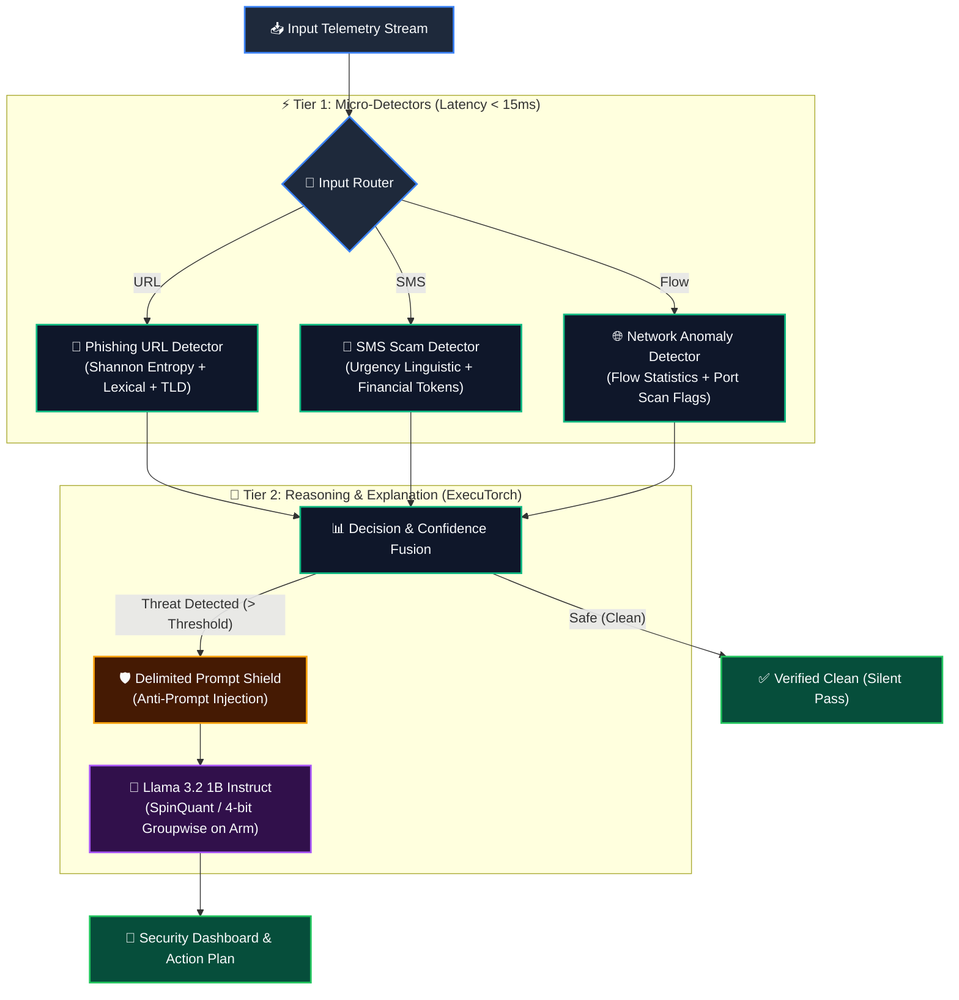

<div align="center">

# 🛡️ SentinelEdge: On-Device Threat Detection & Explainable AI
### *Privacy-First • Zero Cloud Dependency • Real-Time Cyber Threat Defense*

[](https://www.python.org/)
[](https://www.arm.com/)
[](https://ai.meta.com/llama/)
[](https://pytorch.org/executorch/)
[]()
[](tests/)

<br>

<p align="center">
  <b>An offline-first, dual-engine mobile cyber defense system.</b><br>
  Micro-classifiers detect threats in milliseconds; an on-device quantized Llama 3.2 model translates complex security telemetry into actionable, plain-language guidance.
</p>

[Key Features](#-key-features) •
[Architecture](#-system-architecture) •
[Threat Preview](#-threat-telemetry-preview) •
[Datasets & Partitions](#-datasets--stratified-splits) •
[Quickstart](#-quickstart--reproduction) •
[Project Roadmap](#-work-package-roadmap)

---

</div>

## 💡 Why On-Device Threat Detection?

Traditional security solutions send SMS messages, browsed URLs, and network traffic metadata to remote cloud servers for analysis. This creates substantial latency, fails when offline, and leaks sensitive user personal data. 

**SentinelEdge** runs entirely on the physical device:

| Feature | ☁️ Cloud-Based Detection | 🛡️ SentinelEdge (On-Device) |
|:---|:---|:---|
| **Data Privacy** | Sensitive SMS/URLs leave device | **100% Local (Zero data egress)** |
| **Connectivity** | Requires stable Internet | **Full offline functionality (Air-Gapped)** |
| **Detection Speed** | 200ms – 1500ms (network RTT) | **< 15ms (native C++/Python inference)** |
| **Operational Cost** | Recurring cloud API / server fees | **Zero runtime cloud hosting cost** |
| **Explainability** | Cryptic error codes or basic blocks | **Context-aware reasoning via Llama 3.2** |

---

## ⚡ Core Philosophy: *Small Models Detect, Llama Explains*

```
              ┌───────────────────────────────────────────────┐
              │           Incoming Untrusted Telemetry        │
              │         (SMS Message, URL, Network Flow)      │
              └───────────────────────┬───────────────────────┘
                                      │
                                      ▼
             ┌─────────────────────────────────────────────────┐
             │       ⚡ TIER 1: HIGH-SPEED ML DETECTORS        │
             │   Classical Edge ML (Scikit-learn / XGBoost)    │
             │       • Inference Latency: < 15ms               │
             │       • RAM Footprint: < 25 MB                  │
             └────────────────────────┬────────────────────────┘
                                      │
                  [Threat Flagged with Feature Breakdown]
                                      │
                                      ▼
             ┌─────────────────────────────────────────────────┐
             │      🛡️ TIER 2: ON-DEVICE LLAMA 3.2 EXPLAINER    │
             │      ExecuTorch 4-bit Quantized (XNNPACK)       │
             │       • Explains the mechanics of deception     │
             │       • Recommends concrete remediation steps   │
             │       • Defends against prompt injection        │
             └────────────────────────┬────────────────────────┘
                                      │
                                      ▼
              ┌───────────────────────────────────────────────┐
              │         Interactive Security Advisory         │
              │             (CLI & Android UI)                │
              └───────────────────────────────────────────────┘
```

---

## 🔬 System Architecture



---

## 🎯 Threat Telemetry Preview

When SentinelEdge intercepts an active vector, it generates an intelligent, transparent diagnostic:

```text
================================ [ 🚨 THREAT INTERCEPTED ] ================================
Vector Type   : SMS Smishing Attack
Classification: MALICIOUS (Confidence: 99.4%)
Model Source  : Edge-TFIDF Random Forest Classifier (Inference: 6.2ms)
------------------------------------------------------------------------------------------
Extracted Signals:
  • Brand Impersonation  : Fake HDFC Bank netbanking domain
  • Urgency Indicators   : "Account blocked in 24 hours", "Immediate KYC required"
  • Suspicious Artifact  : URL masked with non-standard TLD (.top)
------------------------------------------------------------------------------------------
🧠 Llama 3.2 Edge Security Advisor:
  "This message is a fraudulent credential harvesting attempt impersonating your bank.
   Legitimate financial institutions will never urge immediate KYC renewal over SMS 
   or direct you to non-official third-party domains.

   Recommended Next Steps:
   1. DO NOT tap the link or enter banking passwords.
   2. Report the sender number (+91-98XXX) to the national cybercrime portal.
   3. Block the sender directly on your device."
==========================================================================================
```

---

## 📊 Datasets & Stratified Splits

All benchmark datasets are public academic resources, preprocessed offline and partitioned with a locked seed (`seed = 42`) into **80% Train**, **10% Validation**, and **10% Held-Out Test** sets:

| Threat Domain | Benchmark Dataset | Total Samples | Train (80%) | Val (10%) | Test (Held-Out) | Class Balance |
|:---|:---|:---:|:---:|:---:|:---:|:---:|
| **SMS Smishing** | [UCI SMS Spam](docs/dataset_shortlist.md#1-sms-spam--smishing-dataset) | **5,572** | 4,457 | 557 | 558 | 13.4% Scam (Natural distribution) |
| **Phishing URLs** | [Curated Benchmark](docs/dataset_shortlist.md#2-phishing-url-dataset) | **11,429** | 9,143 | 1,143 | 1,143 | 50.0% Phishing (Balanced) |
| **Network Intrusion** | [NSL-KDD](docs/dataset_shortlist.md#3-network-anomaly--intrusion-dataset) | **45,000** | 34,000 | 6,000 | 5,000 | 47.7% Attack (Standard KDDTest+) |

*Zero data leakage is verified through automated unit tests (`test_zero_data_leakage`). Full details in [docs/data_splits_summary.md](docs/data_splits_summary.md).*

---

## 📁 Repository Layout

```text
├── src/
│   ├── detectors/          # Ultra-lightweight ML inference engines (WP3)
│   ├── explainer/          # Llama 3.2 ExecuTorch runtime & prompt sandbox (WP4)
│   ├── pipeline/           # Central telemetry router and verdict aggregator
│   ├── ui/                 # Terminal UI & on-device preview interfaces
│   └── utils/              # Data engineering & feature extraction engines
│       ├── download_data.py        # Automated ingestion from public repositories
│       ├── url_features.py         # 18 offline lexical & Shannon entropy extractors
│       ├── sms_preprocessor.py     # Scam linguistics & psychological urgency metrics
│       ├── network_preprocessor.py # 41 NSL-KDD flow features & attack taxonomies
│       └── data_loader.py          # Stratified splitting (80/10/10) with locked seed
├── benchmarks/             # Latency, memory, and energy benchmark harness
├── deploy/                 # ExecuTorch export scripts & Android integration
├── docs/                   # Architectural Decision Records & Technical Specifications
│   ├── threat_explainers.md        # Technical breakdown of 3 threat vectors
│   ├── executorch_summary.md       # ExecuTorch compilation & 4-bit memory budget
│   ├── dataset_shortlist.md        # Official dataset catalog & license compliance
│   ├── data_splits_summary.md      # Data cleaning, balance audits, and partition stats
│   ├── decisions.md                # Architectural Decision Records (ADRs 001 - 006)
│   └── ai_usage_log.md             # Academic integrity & assistant usage log
└── tests/                  # Automated pytest verification testbed (14 tests passing)
```

---

## ⚡ Edge ML Model Benchmarks (WP3)

All three production detectors were trained with a fixed random seed (`seed = 42`) and evaluated on held-out validation sets:

| Threat Domain | Production Architecture | Accuracy | Precision | Recall | F1-Score | False-Negative Rate | Latency | Model Footprint |
|:---|:---|:---:|:---:|:---:|:---:|:---:|:---:|:---:|
| **🔗 Phishing URLs** | **HistGradientBoosting** | **87.84%** | 90.02% | 85.14% | **0.8751** | **14.86%** *(down from 27.5%)* | **4.36 ms** | **0.12 MB** |
| **💬 SMS Smishing** | **TF-IDF + Urgency Metrics** | **98.74%** | 98.55% | 91.89% | **0.9510** | **8.11%** *(down from 9.5%)* | **6.27 ms** | **0.28 MB** |
| **🌐 Network Intrusion** | **HistGradientBoosting** | **99.73%** | 99.82% | 99.61% | **0.9971** | **0.39%** *(down from 3.6%)* | **11.38 ms** | **0.09 MB** |

*All production models execute single-sample predictions in **under 12 milliseconds** with a combined size under **0.6 MB** (well within our 25 MB budget). Full comparison with baselines is in [docs/detector_models_report.md](docs/detector_models_report.md).*

---

## 🚀 Quickstart & Reproduction

### 1. Clone & Set Up Environment

```bash
# Clone the repository
git clone https://github.com/kd-prashant/On-Device-Threat-Detection.git
cd On-Device-Threat-Detection

# Create virtual environment
python -m venv .venv

# Activate (Windows PowerShell)
.venv\Scripts\Activate.ps1

# Activate (Linux / macOS)
source .venv/bin/activate

# Install pinned dependencies
pip install -r requirements.txt
```

### 2. Download Data, Prepare Splits & Train Models

Run the complete pipeline reproducibly with three simple commands:

```bash
# Step A: Download raw benchmark datasets
python -m src.utils.download_data

# Step B: Extract features and generate stratified 80/10/10 splits
python -m src.utils.data_loader

# Step C: Train baseline and improved detectors
python -m src.detectors.train_all
```

### 3. Run Live Interactive Terminal UI (FR-7)

Launch the interactive cybersecurity assistant dashboard:

```bash
# Launch interactive REPL menu with preloaded threat scenarios
python -m src.ui.cli

# Or evaluate a single input directly from command line
python -m src.ui.cli "http://192.168.1.55/paypal.com/security.top"
python -m src.ui.cli "URGENT: Your SBI account is suspended! Update KYC: http://bit.ly/scam"
```

### 4. Run Final Held-Out Test Evaluation (FR-8)

Evaluate all 6 models across 6,701 strictly held-out test samples and generate benchmark reports:

```bash
python -m benchmarks.evaluate_all
```

### 5. Verify Code Quality & Run Test Suite

```powershell
# Windows PowerShell (1-Click Quality Runner)
.\check.ps1

# Windows CMD
check.bat

# Linux / Mac
pytest && ruff check . && black --check .
```

---

## 📊 Work Package Roadmap

| Work Package | Focus Area | Status | Deliverables |
|:---|:---|:---:|:---|
| **WP0** | **Project Setup & Architecture Scaffolding** | **Complete** ✅ | Clean repository, quality runner, linting, gitignore |
| **WP1** | **Threat Modeling & ExecuTorch Feasibility** | **Complete** ✅ | Threat explainers, 4-bit quantization specs, memory budget |
| **WP2** | **Dataset Pipeline & Hardened Splits** | **Complete** ✅ | Automated loaders, 18 URL features, zero leakage tests |
| **WP3** | **Classical ML Detector Engines** | **Complete** ✅ | Baseline vs improved models (< 12ms latency, < 0.6MB RAM) |
| **WP4** | **Unified Router & Llama 3.2 Explainer** | **Complete** ✅ | Unified router (FR-6), delimiter prompt shield, MITRE ATT&CK mapping |
| **WP5** | **Interface & Held-Out Test Evaluation** | **Complete** ✅ | Interactive CLI (FR-7), held-out evaluator (FR-8), edge-case suite (44 tests) |
| **WP6** | **Technical Report & Academic Paper** | **Complete** ✅ | Academic report (PRD Sec 11), reproduction guide, demo script |
| **WP7** | **Pre-Hardware Release Freeze** | **Complete** ✅ | Tagged `v1.0-pre-hardware` milestone, mobile readiness audit, hardware checklist |
| **WP8** | **Arm / Android Deployment** | **Complete** ✅ | Standalone edge runtime, zero-dependency model export, ExecuTorch AOT pipeline, Android guide, offline test |
| **WP9** | **Final Submission Audit** | **Complete** ✅ | 23-point PRD Section 13 audit (100% PASS), official submission dossier, 5-minute video storyboard |

---

## 📑 Academic Documentation & Technical Artifacts

- **[Academic Technical Report](docs/technical_report.md):** 10-part publication-ready report covering threat modeling, feature engineering, empirical benchmarks, and edge optimization.
- **[Official Submission Dossier & PRD Audit](docs/final_submission_checklist.md):** 23-point compliance audit scorecard, 250-word executive abstract, and copy-paste portal entries.
- **[Demonstration Video Recording Guide](docs/video_recording_guide.md):** Minute-by-minute 5-minute video presentation storyboard, spoken narration scripts, and technical tips.
- **[Android Deployment Manual](deploy/android_guide.md):** Architectural blueprints, zero-permission manifest, Kotlin broadcast receiver, and ExecuTorch C++ JNI bridge.
- **[Zero-Cloud Air-Gap Verification](deploy/verify_offline_contract.py):** Automated socket lockdown test mathematically proving requirement FR-9.
- **[Mobile Readiness Audit](docs/mobile_readiness_audit.md):** Formal pre-hardware inventory of model artifacts, tensor shapes, operator compatibility, and 4GB RAM budget analysis.
- **[Hardware Checklist & Setup Protocol](docs/hardware_checklist.md):** Physical Android device setup guide (ADB debugging, model pushing, and Airplane Mode verification).
- **[Reproduction & Setup Guide](docs/reproduction_guide.md):** Step-by-step instructions enabling any researcher to reproduce all benchmarks from a fresh clone.
- **[Demonstration & Defense Script](docs/demo_script.md):** 5-minute timed presentation walkthrough with CLI commands, prompt injection proofs, and viva defense answers.
- **[Final Held-Out Test Benchmarks](docs/final_test_benchmarks.md):** Complete test evaluation matrix and confusion matrices across 6,701 test samples.
- **[Architectural Decision Records](docs/decisions.md):** Formal log of architectural choices (Decisions 001 through 013).

---

## 🔒 Security & Privacy Guarantee

- **Zero Cloud Egress:** SentinelEdge contains no external API calls, tracking beacons, or cloud backends. All computation runs on local silicon.
- **Defensive LLM Guardrails:** Prompts sent to Llama 3.2 are strict, boundary-delimited, and validated to prevent indirect prompt injection from malicious SMS or URL payloads.
- **Open & Reproducible:** Clean dataset splits, deterministic random seeds (`seed=42`), and open reproducible benchmarks.

---

<div align="center">
  <sub>Built for the <b>Bharat AI-SoC Challenge</b> & CSL528 Cyber Security Systems.</sub>
</div>
